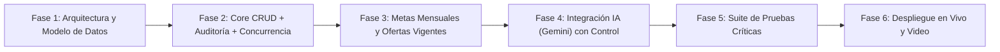

# Portal de Aliados Comerciales — VERLA SAS (MVP)

Plataforma integral para la gestión operativa de la red comercial de **VERLA SAS**: administración de aliados, coordinadores, vendedores y cobertura por ciudades, seguimiento de metas mensuales frente a resultados reales, publicación de ofertas vigentes por período y asistencia con Inteligencia Artificial gobernada (*human-in-the-loop*).

---

## 1. Resumen Ejecutivo y Criterios de Evaluación

El reto técnico evalúa **criterio de diseño arquitectónico y operación real** (no maquetado estático) sobre seis frentes con igual ponderación:

| Frente Evaluado | Alcance y Solución Adoptada |
| :--- | :--- |
| **1. Modelo de Datos** | Esquema relacional normalizado con integridad referencial, versionamiento por fila para concurrencia y tabla de auditoría histórica (`AuditLog`) para trazabilidad completa. |
| **2. MVP Funcional** | CRUD real de aliados, coordinadores, vendedores (ficha de empleado) y ciudades; operación multi-ciudad; comparativa mensual de metas vs. resultados reales; ofertas vigentes con texto e imágenes por período. |
| **3. Uso de IA** | Integración asíncrona con **Google Gemini API (`gemini-2.5-flash`)** para redacción asistida de ofertas y análisis de brechas de metas, con control humano obligatorio y registro de métricas (`AIAuditLog`). |
| **4. Pruebas y Bloqueo** | RBAC por rol (Administrador, Aliado, Coordinador, Vendedor), control de edición concurrente mediante *Optimistic Locking* (`version` + HTTP `409 Conflict`) y suite automatizada de pruebas. |
| **5. Despliegue y Plan** | Aplicación contenedorizada y desplegada en vivo sobre servidor Rust ASGI (**Granian**), acompañada de cronograma de ejecución con entregables verificables. |
| **6. Sustentación (Video)** | Defensa técnica de 5 a 8 minutos cubriendo arquitectura, decisiones de diseño y demostración del sistema operando en vivo. |

---

## 2. Requerimientos del Negocio y Alcance del MVP

### 2.1 Reglas de Negocio
- **Aliado Comercial**: Titular del contrato comercial y responsable directo de su red de coordinadores y vendedores.
- **Coordinadores y Vendedores**: Cada aliado cuenta con coordinadores y vendedores asignados. Todo vendedor posee una **ficha de empleado** con datos propios: documento de identidad, datos de contacto, cargo, ciudad base, fecha de ingreso y estado operativo.
- **Cobertura Geográfica y Estados**: Un vendedor puede operar en **una o varias ciudades** y encontrarse en estado `ACTIVO`, `INACTIVO` o `BLOQUEADO` (un vendedor bloqueado o inactivo tiene restringida su operación comercial según las reglas del dominio).
- **Metas vs. Resultados Reales**: Se miden mensualmente (`YYYY-MM`) permitiendo agregación y trazabilidad por **vendedor**, **coordinador** y **aliado**.
- **Ofertas Vigentes por Período**: Publicación de promociones y condiciones comerciales con contenido textual e imágenes variables según el período de vigencia, visibles para la fuerza de ventas activa.

### 2.2 Entregables Exigidos
- [ ] **Arquitectura y Modelo de Datos**: Diagrama Entidad-Relación (DER) y diccionario de datos detallado.
- [ ] **MVP Funcional en Vivo**: Operaciones CRUD completas con historial de cambios auditable.
- [ ] **Seguridad, Roles y Concurrencia**: Matriz de permisos por rol y prevención de pérdida de actualizaciones (*lost updates*) en edición simultánea.
- [ ] **Módulo de IA con Control**: Documentación e implementación de dónde aporta valor, con qué guardrails opera y cómo se mide su efectividad.
- [ ] **Estrategia de Pruebas**: Pruebas automatizadas de reglas críticas de negocio, permisos y colisiones de concurrencia.
- [ ] **Despliegue y Cronograma**: URL pública funcional, plan de trabajo con hitos/fechas y video de sustentación (5–8 min).

---

## 3. Stack Tecnológico Definido

El stack fue seleccionado priorizando **robustez transaccional, velocidad de entrega (sprint de 17 horas) y rendimiento en producción**:

| Capa | Tecnología | Justificación Arquitectónica |
| :--- | :--- | :--- |
| **Lenguaje y Runtime** | **Python 3.14** | Tipado moderno, mejoras de rendimiento del intérprete y soporte de ruedas binarias (`cp314`) en todo el stack seleccionado. |
| **Framework Backend** | **Django 5.x / 6.x (ORM + Auth + Templates)** | Baterías incluidas para autenticación, RBAC nativo, protección CSRF, migraciones deterministas y soporte transaccional (`select_for_update` / `F()` expressions). |
| **Servidor HTTP / ASGI** | **Granian (`--interface asgi`)** | Servidor HTTP en Rust (Hyper/Tokio) que ejecuta la aplicación ASGI y sirve `/static` y `/media` directamente desde Rust sin sobrecargar los workers de Python ni requerir WhiteNoise. |
| **Frontend y Estética** | **Pico CSS (CDN) + Vanilla JS (ES6+)** | Interfaz semántica, minimalista y responsiva sin advertencias de compiladores JIT en navegador ni complejidad de bundlers Node.js. |
| **Serialización y Minificación** | **`ManifestStaticFilesStorage` + `rjsmin` / `rcssmin` + `django-minify-html`** | Pipeline 100% nativo en `collectstatic`: minifica archivos `.js` y `.css`, agrega hash MD5 al nombre del archivo para *cache-busting* inmutable y minifica el HTML en tiempo de respuesta. |
| **Base de Datos** | **SQLite 3 en modo WAL (`transaction_mode=IMMEDIATE`)** | Motor ACID embebido con cero latencia de red, lecturas no bloqueantes (`WAL`), cola de escritura segura (`busy_timeout=5000`), soporte atómico para *Optimistic Locking* y portabilidad inmediata a PostgreSQL mediante el ORM de Django. |
| **Inteligencia Artificial** | **Google Gemini API (`gemini-2.5-flash`) vía `httpx.AsyncClient`** | Endpoint asíncrono no bloqueante con salida JSON estructurada, tier gratuito sin fricción y capa de auditoría (`AIAuditLog`). |

---

## 4. Estrategia de Ejecución y Plan de Abordaje (Sprint 17 Horas)

El desarrollo se estructura en **6 fases incrementales**. La integración de IA se ubica estratégicamente después de construir el núcleo transaccional (CRUD, metas y ofertas) para que el modelo opere sobre **datos reales del dominio**.

### Detalle del Cronograma Operativo (11 Nov 16:00 – 12 Nov 09:00)

| Fase | Ventana Estimada | Entregable Verificable |
| :--- | :--- | :--- |
| **Fase 1: Modelo de Datos y Base del Proyecto** | 11 Nov · 16:30 – 18:00 | Inicialización de Django sobre Python 3.14 + Granian, configuración de minificación/serialización de estáticos, diseño del DER, diccionario de datos y migraciones iniciales. |
| **Fase 2: Red Comercial, Roles y Concurrencia** | 11 Nov · 18:00 – 21:00 | CRUD de Ciudades, Aliados, Coordinadores y Vendedores (ficha completa y asignación multi-ciudad), RBAC por rol, historial de cambios (`AuditLog`) y bloqueo optimista (`version`). |
| **Fase 3: Metas Mensuales y Ofertas por Período** | 11 Nov · 21:00 – 23:30 | Tablero de Metas vs. Resultados reales (por vendedor, coordinador y aliado) y módulo de Ofertas vigentes con carga de imágenes y vista dedicada para el vendedor. |
| **Fase 4: Uso de IA (Google Gemini)** | 11 Nov · 23:30 – 01:30 | Servicio asíncrono (`async def`) conectado a Gemini para generación asistida de ofertas y diagnóstico de cumplimiento de metas, con aprobación humana y telemetría en `AIAuditLog`. |
| **Fase 5: Pruebas Automatizadas y Casos Críticos** | 12 Nov · 01:30 – 03:30 | Pruebas unitarias y de integración cubriendo colisión de edición concurrente (`409 Conflict`), restricciones de vendedores bloqueados/inactivos, cálculo de metas y fallback de IA. |
| **Fase 6: Despliegue, Documentación Final y Video** | 12 Nov · 03:30 – 08:30 | Despliegue en la nube verificable, revisión final de documentación técnica y grabación/envío del video de defensa (5 a 8 minutos) antes de las 09:00 a.m. |

---

## 5. Diseño de Gobernanza para Concurrencia e IA

### 5.1 Control de Bloqueo y Edición Concurrente
- **Bloqueo Optimista (*Optimistic Concurrency Control*)**: Cada entidad editable (`Aliado`, `Coordinador`, `Vendedor`, `MetaMensual`, `OfertaPeriodo`) incluye un campo entero `version`. Toda actualización valida `WHERE id = :id AND version = :current_version` incrementando `version = version + 1` de forma atómica. Si otro usuario modificó el registro previamente, el sistema rechaza la escritura con estado `409 Conflict`, preserva los cambios en pantalla y exige recargar o confirmar antes de sobrescribir.
- **Trazabilidad (`AuditLog`)**: Cada creación, actualización o cambio de estado (`ACTIVO`, `INACTIVO`, `BLOQUEADO`) registra actor, fecha/hora UTC, entidad, identificador, snapshot `before/after` en JSON y versión resultante.

### 5.2 Inteligencia Artificial: Real, Medible y con Control
1. **¿Dónde aporta y para qué?**:
   - **Asistente de Redacción de Ofertas**: Genera propuestas de texto comercial estructurado para un período y segmento específico.
   - **Analista de Cumplimiento Comercial**: Evalúa las desviaciones entre metas del mes y resultados reales por aliado/coordinador/vendedor y sugiere acciones correctivas.
2. **¿Con qué control?**:
   - *Human-in-the-loop*: La IA jamás modifica registros directamente; devuelve un borrador estructurado que el usuario con permisos debe revisar, editar si corresponde y aprobar explícitamente.
   - Validación estricta de esquema JSON, *timeout* controlado, límite de invocaciones y *fallback* determinista en caso de indisponibilidad de red.
3. **¿Cómo se mide?**:
   - Registro en `AIAuditLog` de latencia en milisegundos, tokens utilizados, usuario solicitante y decisión final del operador (`ACEPTADO`, `EDITADO`, `DESCARTADO`).
