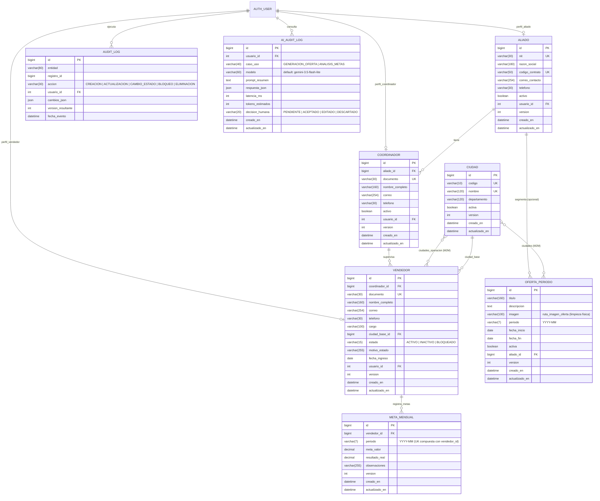

# Modelo de Datos y Diccionario de Datos — Portal de Aliados Comerciales VERLA SAS

Este documento especifica el esquema relacional, las restricciones de integridad, el control de concurrencia optimista (`version`) y el diccionario de datos de la base de datos SQLite 3 (`db.sqlite3` en modo WAL) para las 3 aplicaciones de dominio (`red_comercial`, `operacion`, `asistente_ia`).

---

## 1. Flujo de Dependencias y Principios del Esquema

- **Flujo unidireccional de dependencias**: `asistente_ia` -> `operacion` -> `red_comercial`.
- **Concurrencia Optimista (`VersionedModel`)**: Todas las entidades editables incluyen la columna entera `version` (inicia en `1`). Las actualizaciones validan atómicamente `WHERE id = :id AND version = :expected_version` e incrementan `version = version + 1`. Si otro usuario modificó el registro previamente, se lanza `ConcurrentModificationError` (traducido en la capa HTTP como `409 Conflict`).
- **Trazabilidad e Historial (`AuditLog`)**: Cada creación, edición o transición de estado/bloqueo registra el diferencial antes/después en formato JSON (`cambios_json`), el usuario actor y la versión resultante.
- **Extracción de Diagrama ER en DBeaver**: El archivo `db.sqlite3` en la raíz del proyecto se inicializa con `PRAGMA foreign_keys=ON;`. Al abrir `db.sqlite3` en DBeaver y seleccionar el esquema principal -> pestaña **ER Diagram**, todas las llaves foráneas y tablas puente M2M se visualizan automáticamente.

---

## 2. Diagrama Entidad-Relación (Mermaid ER)

---

## 3. Diccionario de Datos por Tabla

### 3.1. `red_comercial_ciudad` (`Ciudad`)
Catálogo oficial de ciudades donde opera la fuerza de ventas de VERLA SAS.

| Columna | Tipo SQL | Nulo | Restricciones / Índices | Descripción |
| :--- | :--- | :--- | :--- | :--- |
| `id` | `INTEGER` | No | `PK`, `AUTOINCREMENT` | Identificador único de la ciudad. |
| `codigo` | `VARCHAR(10)` | No | `UNIQUE` | Código corto estandarizado (ej. `BOG`, `MED`, `CLO`). |
| `nombre` | `VARCHAR(120)` | No | `UNIQUE` | Nombre oficial del municipio o distrito. |
| `departamento` | `VARCHAR(120)` | No | — | Departamento al que pertenece la ciudad. |
| `activa` | `BOOL` | No | `DEFAULT 1` | Indica si la ciudad está habilitada para operación comercial. |
| `version` | `INTEGER UNSIGNED` | No | `DEFAULT 1` | Versión para control de concurrencia optimista. |
| `creado_en` | `DATETIME` | No | — | Marca temporal de creación del registro. |
| `actualizado_en` | `DATETIME` | No | — | Marca temporal de última actualización. |

---

### 3.2. `red_comercial_aliado` (`Aliado`)
Entidad jurídica titular de un contrato de distribución comercial con VERLA SAS.

| Columna | Tipo SQL | Nulo | Restricciones / Índices | Descripción |
| :--- | :--- | :--- | :--- | :--- |
| `id` | `INTEGER` | No | `PK`, `AUTOINCREMENT` | Identificador único del aliado comercial. |
| `nit` | `VARCHAR(30)` | No | `UNIQUE` | Número de Identificación Tributaria con dígito de verificación. |
| `razon_social` | `VARCHAR(180)` | No | — | Nombre legal o razón social de la empresa aliada. |
| `codigo_contrato` | `VARCHAR(50)` | No | `UNIQUE` | Código de contrato marco suscrito con VERLA SAS. |
| `correo_contacto` | `VARCHAR(254)` | No | — | Correo electrónico principal de notificaciones. |
| `telefono` | `VARCHAR(30)` | No | — | Teléfono de contacto corporativo. |
| `activo` | `BOOL` | No | `DEFAULT 1` | Si es `0`, inhabilita operativamente a toda su red asociada. |
| `usuario_id` | `INTEGER` | Sí | `UNIQUE`, `FK -> auth_user(id)` (`SET NULL`) | Cuenta de usuario opcional asociada al perfil de Aliado. |
| `version` | `INTEGER UNSIGNED` | No | `DEFAULT 1` | Versión para control de concurrencia optimista. |
| `creado_en` | `DATETIME` | No | — | Fecha y hora de creación. |
| `actualizado_en` | `DATETIME` | No | — | Fecha y hora de última modificación. |

---

### 3.3. `red_comercial_coordinador` (`Coordinador`)
Supervisor comercial perteneciente a un `Aliado` y responsable de un equipo de vendedores.

| Columna | Tipo SQL | Nulo | Restricciones / Índices | Descripción |
| :--- | :--- | :--- | :--- | :--- |
| `id` | `INTEGER` | No | `PK`, `AUTOINCREMENT` | Identificador único del coordinador. |
| `aliado_id` | `BIGINT` | No | `FK -> red_comercial_aliado(id)` (`PROTECT`) | Aliado comercial al que pertenece el coordinador. |
| `documento` | `VARCHAR(30)` | No | `UNIQUE` | Documento de identidad del coordinador. |
| `nombre_completo` | `VARCHAR(160)` | No | — | Nombres y apellidos completos. |
| `correo` | `VARCHAR(254)` | No | — | Correo electrónico corporativo. |
| `telefono` | `VARCHAR(30)` | No | — | Número de contacto móvil. |
| `activo` | `BOOL` | No | `DEFAULT 1` | Indica si el coordinador se encuentra activo. |
| `usuario_id` | `INTEGER` | Sí | `UNIQUE`, `FK -> auth_user(id)` (`SET NULL`) | Cuenta de usuario opcional asociada al rol Coordinador. |
| `version` | `INTEGER UNSIGNED` | No | `DEFAULT 1` | Versión para control de concurrencia optimista. |
| `creado_en` | `DATETIME` | No | — | Fecha y hora de creación. |
| `actualizado_en` | `DATETIME` | No | — | Fecha y hora de última actualización. |

---

### 3.4. `red_comercial_vendedor` (`Vendedor`) y `red_comercial_vendedor_ciudades_operacion`
Ficha de funcionario comercial asignado a un `Coordinador`, con ciudad base, operación multiciudad y control de bloqueo operativo.

| Columna | Tipo SQL | Nulo | Restricciones / Índices | Descripción |
| :--- | :--- | :--- | :--- | :--- |
| `id` | `INTEGER` | No | `PK`, `AUTOINCREMENT` | Identificador único del vendedor. |
| `coordinador_id` | `BIGINT` | No | `FK -> red_comercial_coordinador(id)` (`PROTECT`) | Coordinador responsable directo del vendedor (determina el Aliado por 3FN). |
| `documento` | `VARCHAR(30)` | No | `UNIQUE` | Cédula o documento de identidad del funcionario. |
| `nombre_completo` | `VARCHAR(160)` | No | — | Nombre completo del funcionario. |
| `correo` | `VARCHAR(254)` | No | — | Correo electrónico del vendedor. |
| `telefono` | `VARCHAR(30)` | No | — | Teléfono móvil del vendedor. |
| `cargo` | `VARCHAR(100)` | No | `DEFAULT 'Asesor Comercial'` | Cargo dentro de la estructura comercial. |
| `ciudad_base_id` | `BIGINT` | No | `FK -> red_comercial_ciudad(id)` (`PROTECT`) | Sede principal o ciudad base del funcionario. |
| `estado` | `VARCHAR(15)` | No | `INDEX`, `DEFAULT 'ACTIVO'` | Estado operativo: `ACTIVO`, `INACTIVO` o `BLOQUEADO`. |
| `motivo_estado` | `VARCHAR(255)` | No | `DEFAULT ''` | Justificación de inactivación o bloqueo operativo. |
| `fecha_ingreso` | `DATE` | No | — | Fecha de vinculación a la red comercial. |
| `usuario_id` | `INTEGER` | Sí | `UNIQUE`, `FK -> auth_user(id)` (`SET NULL`) | Usuario del portal para vista de vendedor. |
| `version` | `INTEGER UNSIGNED` | No | `DEFAULT 1` | Versión para control de concurrencia optimista. |
| `creado_en` | `DATETIME` | No | — | Fecha y hora de creación. |
| `actualizado_en` | `DATETIME` | No | — | Fecha y hora de última modificación. |

- **Tabla puente M2M `red_comercial_vendedor_ciudades_operacion`**:
  - `vendedor_id` (`FK -> red_comercial_vendedor.id`)
  - `ciudad_id` (`FK -> red_comercial_ciudad.id`)
  - Restricción única compuesta `(vendedor_id, ciudad_id)` que permite a un mismo vendedor operar en una o múltiples ciudades.

- **Normalización en Tercera Forma Normal (3FN)**:
  - `Vendedor` **no almacena** una columna redundante `aliado_id`, ya que el aliado comercial se deriva funcionalmente a través del `Coordinador` responsable directo (`vendedor.coordinador.aliado`). Esto evita anomalías de actualización y desincronización en la jerarquía comercial.
- **Propiedades del Modelo y Métodos de Negocio**:
  - `@property aliado`: Resuelve dinámicamente el `Aliado` titular a través de `self.coordinador.aliado`.
  - `@property puede_operar`: Regla de guarda que valida que el vendedor esté en `ACTIVO` y que tanto su coordinador como su aliado comercial se encuentren activos (`self.estado == EstadoVendedor.ACTIVO and self.coordinador.activo and self.coordinador.aliado.activo`).
  - `cambiar_estado(nuevo_estado, expected_version, usuario, motivo)`: Ejecuta la transición de estado bajo bloqueo optimista y clasifica la acción en `AuditLog` como `BLOQUEO` (si el nuevo estado es `BLOQUEADO`) o `CAMBIO_ESTADO`.

---

### 3.5. `red_comercial_auditlog` (`AuditLog`)
Bitácora inmutable de auditoría de cambios sobre las entidades del portal.

| Columna | Tipo SQL | Nulo | Restricciones / Índices | Descripción |
| :--- | :--- | :--- | :--- | :--- |
| `id` | `INTEGER` | No | `PK`, `AUTOINCREMENT` | Identificador único del evento de auditoría. |
| `entidad` | `VARCHAR(80)` | No | `INDEX` | Nombre de la clase de modelo auditada (ej. `Vendedor`, `Aliado`). |
| `registro_id` | `BIGINT UNSIGNED` | No | `INDEX` | Llave primaria del registro afectado. |
| `accion` | `VARCHAR(30)` | No | — | Tipo de evento: `CREACION`, `ACTUALIZACION`, `CAMBIO_ESTADO`, `BLOQUEO`, `ELIMINACION`. |
| `usuario_id` | `INTEGER` | Sí | `FK -> auth_user(id)` (`SET NULL`) | Actor autenticado que ejecutó la operación. |
| `cambios_json` | `JSON` | No | — | Diccionario `{campo: {"antes": valor_anterior, "despues": valor_nuevo}}`. |
| `version_resultante` | `INTEGER UNSIGNED` | No | `DEFAULT 1` | Número de versión del registro tras aplicar el cambio. |
| `fecha_evento` | `DATETIME` | No | `INDEX` | Marca de tiempo exacta del evento. |

- **Propiedades de Serialización**:
  - `@property cambios_json_str`: Retorna el diferencial `cambios_json` formateado como cadena JSON válida (`json.dumps(..., ensure_ascii=False)`), garantizando renderizado seguro en templates y payloads de inspección.

---

### 3.6. `operacion_metamensual` (`MetaMensual`)
Registro de metas comerciales mensuales vs. resultados reales por vendedor y periodo (`YYYY-MM`).

| Columna | Tipo SQL | Nulo | Restricciones / Índices | Descripción |
| :--- | :--- | :--- | :--- | :--- |
| `id` | `INTEGER` | No | `PK`, `AUTOINCREMENT` | Identificador único de la meta mensual. |
| `vendedor_id` | `BIGINT` | No | `FK -> red_comercial_vendedor(id)` (`CASCADE`) | Vendedor al cual se asigna la meta. |
| `periodo` | `VARCHAR(7)` | No | `INDEX`, `UNIQUE compuesta (vendedor_id, periodo)` | Periodo mensual en formato `YYYY-MM`. Restricción `uniq_meta_vendedor_periodo`. |
| `meta_valor` | `DECIMAL(14, 2)` | No | — | Valor monetario de la meta asignada en el mes. |
| `resultado_real` | `DECIMAL(14, 2)` | No | `DEFAULT 0.00` | Valor monetario real ejecutado acumulada en el mes. |
| `observaciones` | `VARCHAR(255)` | No | `DEFAULT ''` | Notas operativas o seguimiento de cumplimiento. |
| `version` | `INTEGER UNSIGNED` | No | `DEFAULT 1` | Versión para control de concurrencia optimista. |
| `creado_en` | `DATETIME` | No | — | Fecha y hora de creación. |
| `actualizado_en` | `DATETIME` | No | — | Fecha y hora de última modificación. |

- **Restricción de Integridad Única**:
  - `uniq_meta_vendedor_periodo`: `models.UniqueConstraint(fields=["vendedor", "periodo"], name="uniq_meta_vendedor_periodo")`. Impide duplicar asignaciones de meta para el mismo asesor en un mismo mes.
- **Propiedades y Métodos de Agregación Jerárquica**:
  - `@property brecha`: Diferencia monetaria `resultado_real - meta_valor` (negativo indica déficit).
  - `@property porcentaje_cumplimiento`: Porcentaje calculado `(resultado_real / meta_valor) * 100` redondeado a dos decimales.
  - `MetaMensual.resumen_por_coordinador(periodo, aliado_id=None)`: Agrega metas y ventas reales por equipo de coordinador.
  - `MetaMensual.resumen_por_aliado(periodo)`: Agrega metas y ventas reales consolidadas por aliado comercial.

---

### 3.7. `operacion_ofertaperiodo` (`OfertaPeriodo`) y `operacion_ofertaperiodo_ciudades`
Ofertas promocionales vigentes por periodo con soporte de textos comerciales, imagen (`ImageField`) y segmentación por aliado/ciudades.

| Columna | Tipo SQL | Nulo | Restricciones / Índices | Descripción |
| :--- | :--- | :--- | :--- | :--- |
| `id` | `INTEGER` | No | `PK`, `AUTOINCREMENT` | Identificador único de la oferta. |
| `titulo` | `VARCHAR(160)` | No | — | Título comercial de la promoción. |
| `descripcion` | `TEXT` | No | — | Condiciones comerciales, tarifas y beneficios de la oferta. |
| `imagen` | `VARCHAR(100)` | Sí | `upload_to=ruta_imagen_oferta` | Pieza gráfica promocional con ruta trazable y depuración física de archivos. |
| `periodo` | `VARCHAR(7)` | No | `INDEX` | Periodo comercial de referencia (`YYYY-MM`). |
| `fecha_inicio` | `DATE` | No | — | Fecha de inicio de vigencia de la oferta. |
| `fecha_fin` | `DATE` | No | — | Fecha final de vigencia (`fecha_fin >= fecha_inicio`). |
| `activa` | `BOOL` | No | `INDEX`, `DEFAULT 1` | Permite activar o retirar inmediatamente la oferta del portal. |
| `aliado_id` | `BIGINT` | Sí | `FK -> red_comercial_aliado(id)` (`CASCADE`) | Si es `NULL`, aplica a todos los aliados; si se define, es exclusiva. |
| `version` | `INTEGER UNSIGNED` | No | `DEFAULT 1` | Versión para control de concurrencia optimista. |
| `creado_en` | `DATETIME` | No | — | Fecha y hora de creación. |
| `actualizado_en` | `DATETIME` | No | — | Fecha y hora de última modificación. |

- **Tabla puente M2M `operacion_ofertaperiodo_ciudades`**:
  - `ofertaperiodo_id` (`FK -> operacion_ofertaperiodo.id`)
  - `ciudad_id` (`FK -> red_comercial_ciudad.id`)
  - Si una oferta no tiene filas asociadas en esta tabla puente, se considera de cobertura nacional para todas las ciudades activas.
- **Ruta Trazable y Eliminación Física de Archivos (`ruta_imagen_oferta`)**:
  - La ruta del archivo en disco se genera mediante la función invocable `ruta_imagen_oferta`:  
    `ofertas/<año>/<mes>/audit_oferta_<id_o_nueva>_<periodo>_<timestamp>_<slug>.<ext>`.
  - **Depuración física de obsoletos**:
    1. Al editar y reemplazar una imagen mediante `VersionedModel.optimistic_update`, el archivo previo se elimina físicamente de `media/` con reintento seguro contra bloqueos de concurrencia en Windows (`_eliminar_archivo_storage_seguro`).
    2. Al eliminar la oferta (`delete()` o señal `post_delete`), se purga de inmediato el archivo físico para garantizar cero archivos huérfanos en almacenamiento.
- **Regla de Visibilidad Operativa (`visibles_para_vendedor`)**:
  - `OfertaPeriodo.visibles_para_vendedor(vendedor, fecha)`: Retorna queryset filtrando ofertas activas en rango de fechas vigentes aplicables al aliado del vendedor y a sus ciudades (ciudad base y ciudades de operación). Si el vendedor está `INACTIVO` o `BLOQUEADO` (`not vendedor.puede_operar`), retorna un queryset vacío `none()`.

---

### 3.8. `asistente_ia_aiauditlog` (`AIAuditLog`)
Bitácora de auditoría, telemetría y control humano (*human-in-the-loop*) para cada interacción con el Asistente de IA (Google Gemini `gemini-3.5-flash-lite`).

| Columna | Tipo SQL | Nulo | Restricciones / Índices | Descripción |
| :--- | :--- | :--- | :--- | :--- |
| `id` | `INTEGER` | No | `PK`, `AUTOINCREMENT` | Identificador único de la consulta al modelo IA. |
| `usuario_id` | `INTEGER` | Sí | `FK -> auth_user(id)` (`SET NULL`) | Usuario que solicitó la asistencia de IA. |
| `caso_uso` | `VARCHAR(40)` | No | `INDEX` | Caso de uso: `GENERACION_OFERTA` o `ANALISIS_METAS`. |
| `modelo` | `VARCHAR(60)` | No | `DEFAULT 'gemini-3.5-flash-lite'` | Identificador del modelo invocado (`gemini-3.5-flash-lite`). |
| `prompt_resumen` | `TEXT` | No | — | Contexto o parámetros enviados al generador. |
| `respuesta_json` | `JSON` | No | — | Respuesta estructurada devuelta por el asistente. |
| `latencia_ms` | `INTEGER UNSIGNED` | No | `DEFAULT 0` | Tiempo de respuesta medido en milisegundos. |
| `tokens_estimados` | `INTEGER UNSIGNED` | No | `DEFAULT 0` | Conteo total de tokens reportados o estimados. |
| `decision_humana` | `VARCHAR(20)` | No | `INDEX`, `DEFAULT 'PENDIENTE'` | Veredicto humano: `PENDIENTE`, `ACEPTADO`, `EDITADO`, `DESCARTADO`. |
| `creado_en` | `DATETIME` | No | `INDEX`, `idx_aiaudit_user_created` | Fecha y hora de la consulta al asistente. |
| `actualizado_en` | `DATETIME` | No | — | Fecha y hora en que se registró la decisión humana. |

- **Propiedades de Serialización y Racionamiento de Cuotas**:
  - `@property respuesta_json_str`: Serializa de forma segura el contenido JSON a cadena de texto para consumo en vistas o inspectores.
  - **Índice compuesto de rendimiento para cuotas en tiempo real**:
    - `idx_aiaudit_user_created` sobre `(usuario_id, creado_en)`: Permite resolver el conteo de cuota de solicitudes por usuario (15 cada 2 min y 50 por día) en <1ms mediante un index-only scan directo en la base de datos sin sobrecargar la CPU.
